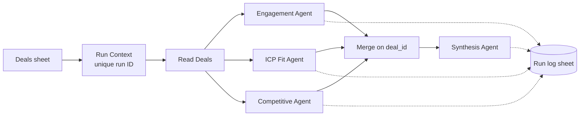

# Deal Risk Agent

A multi-agent workflow that reviews open deals and flags which ones are at risk, why, and what the rep should do next. Built in n8n with Claude, run on 50 synthetic deals.

## The problem

Pipeline reviews usually come down to a manager reading deal notes and going with their gut. Risk signals are spread across activity data, deal fit, and notes about competitors, and nobody has time to check every deal the same way every week.

This workflow checks each deal from three angles, then combines them into one risk call with a recommended next step.

## How it works



| Agent | Looks at | Returns |
|---|---|---|
| Engagement | Emails, meetings, response time, notes | Low / Medium / High risk |
| ICP Fit | Industry, deal size, buyer title | Strong / Moderate / Weak fit |
| Competitive | Notes for competitor names and price comparisons | Low / Medium / High risk, competitors named |
| Synthesis | The three findings above | Overall risk, confidence, next step, reasoning |

Each agent runs on Claude Sonnet 5 at low temperature and returns structured JSON, so every output has the same shape and can be logged and analyzed. The synthesis agent weighs engagement most heavily, then fit, then competition, which matches how most sales leaders triage.

## Design decisions

**Merging on `deal_id`, not row order.** The three agents run in parallel and their results get combined before synthesis. Combining by position only works if every branch returns the same deals in the same order. If a branch ever filtered or dropped a deal, results would shift and the synthesis agent would score one deal using another deal's findings, with no error. Every branch carries `deal_id`, and the merge is a SQL join on it:

```sql
SELECT e.deal_id, e.company_name, e.engagement_output, i.icp_output, c.competitive_output
FROM input1 AS e
LEFT JOIN input2 AS i ON e.deal_id = i.deal_id
LEFT JOIN input3 AS c ON e.deal_id = c.deal_id
```

**A unique run ID per run.** n8n's execution counter reset once when the hosting database was rebuilt, which would have made old and new runs share IDs. Each run now gets an ID built from its start time plus the execution number, so runs never collide.

**Every agent output is logged.** Each finding is written to a log with the run ID and deal ID, so any synthesis result can be traced back to the three findings behind it.

## Results

One full run scored all 50 deals ($14.7M in pipeline) with 200 Claude calls, at an estimated $1 in API cost. (Token logging is on the to-do list below, so this is an estimate from prompt sizes, not a measured number.)

| Overall risk | Deals | Pipeline | Share |
|---|---|---|---|
| Low | 24 | $7.26M | 49% |
| Medium | 17 | $4.64M | 32% |
| High | 9 | $2.81M | 19% |

What stood out:

- **High risk is concentrated late in the funnel.** 6 of the 9 High risk deals ($1.9M) are already in Contract Review or Final Approval, which is where a slip hurts the forecast most.
- **Good fit doesn't mean safe.** 8 of the 9 High risk deals are a Strong ICP fit. The risk comes from engagement (a silent economic buyer, a champion who left) and competitors, not from chasing the wrong accounts.
- **The synthesis agent weighs signals instead of averaging them.** D-1013 mentions a competitor, but the notes say the deal already beat them in a technical bakeoff, so the call is Low risk. D-1047 has strong engagement, but the only contact is a Senior Buyer with no Director-level sponsor, so it lands at Medium with a next step to find one.

Example output for one deal:

> **D-1024, Fieldstone Aerospace, $488K: High risk (0.85)**
> Next step: Re-engage the CFO with a tailored value/ROI case and expedite a competitive pricing response to counter the active BairesDev bid.
> Why: Strong ICP fit, but engagement is thin and slow (5 emails, 1 meeting, 6.2-day response lag) and procurement is actively soliciting a competing bid.

Full output: [`data/sample_results.csv`](data/sample_results.csv). Summary script: [`analysis/summarize_results.py`](analysis/summarize_results.py).

## Run it yourself

1. Import `workflow/deal-risk-orchestrator.public.n8n.json` into n8n (any recent version, cloud or self-hosted).
2. Connect your own Anthropic and Google Sheets credentials on the nodes marked `REPLACE_ME`.
3. Load `data/sample_deals.csv` into a Google Sheet and point **Read Deals** at it. Point the four log nodes at a second sheet with these columns: `run_id, timestamp, agent_name, input_tokens, output_tokens, cost_usd, latency_ms, output_summary, deal_id`.
4. Click **Execute workflow**.

To run the summary:

```bash
pip install -r requirements.txt
python analysis/summarize_results.py
```

## Repo contents

| Path | What it is |
|---|---|
| `workflow/` | The n8n workflow, with credentials and sheet IDs removed |
| `data/sample_deals.csv` | 50 synthetic deals (all company and contact names are made up) |
| `data/sample_results.csv` | Agent scores from one full run |
| `analysis/summarize_results.py` | Pandas script that turns the scores into pipeline views |

## What I'd add next

- Log token usage and latency per call so cost per deal is measured, not estimated
- Post the High risk deals to Slack each Monday
- Run it on a schedule against CRM data instead of a sheet
- Track how often the agent's risk call matches whether the deal actually closed

## Notes

All data is synthetic. Company names, contacts, and deal details are invented for this project.
