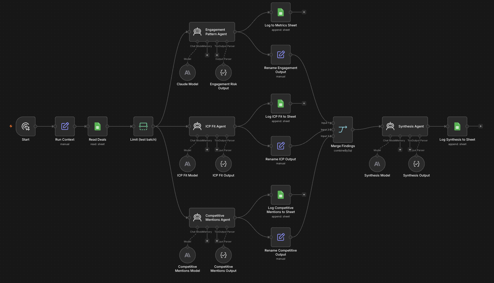
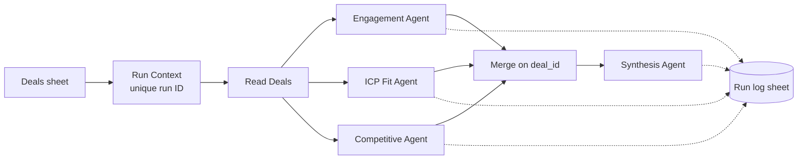
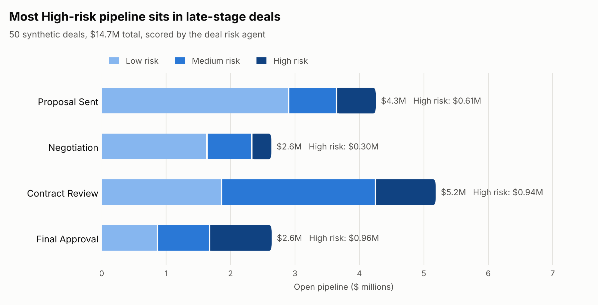

# Deal Risk Agent

A multi-agent workflow that reviews open deals and flags which ones are at risk, why, and what the rep should do next. Built in n8n with Claude, run on 50 synthetic deals.

## The problem

Pipeline reviews usually come down to a manager reading deal notes and going with their gut. Risk signals are spread across activity data, deal fit, and notes about competitors, and nobody has time to check every deal the same way every week.

This workflow checks each deal from three angles, then combines them into one risk call with a recommended next step.

## How it works





Each agent runs on Claude Sonnet 5 at low temperature (0.1) and returns structured JSON, so every output has the same shape and can be logged and analyzed.

## The agents

Each agent is a specialist with one job, a fixed set of inputs, and a fixed output shape.

| Agent | Specialty | Sees only | Returns |
|---|---|---|---|
| **Engagement** | Buyer engagement analyst. Judges whether the buyer is active or going quiet. | Company name, email count, meeting count, average response lag, deal notes | Risk (Low / Medium / High), confidence, one-sentence reason |
| **ICP Fit** | Ideal customer profile analyst. Judges whether this is the right kind of deal. | Company name, industry, deal amount, contact title, plus the ICP rules ($50K+ deal, Director-level or above buyer, no startups, government, or education) | Fit (Strong / Moderate / Weak), confidence, one-sentence reason |
| **Competitive** | Competitive intelligence analyst. Looks for competitor names, price comparisons, and competing bids. | Company name, deal notes | Risk (Low / Medium / High), confidence, competitors named, one-sentence reason |
| **Synthesis** | Deal reviewer. Combines the three findings into one call, weighting engagement most, then fit, then competition (the way most sales leaders triage). | Company name, deal ID, and the three specialists' findings. Never the raw deal data. | Overall risk, confidence, recommended next step, one-to-two sentence reason |

### Tools

None of the agents has tools that touch the outside world. Each agent's Tool and Memory slots in n8n are empty. The only tool each one receives is the JSON formatter n8n attaches for structured output, which lets it hand back an answer and nothing else.

| Capability | Agents have it? | Who does it instead |
|---|---|---|
| Read the deal data | Only the fields passed in their prompt | n8n reads the sheet and builds each prompt |
| Search the web or look up companies | No | Not done |
| Remember previous deals or runs | No | Each call starts fresh |
| Write to the sheet, CRM, or anywhere else | No | Fixed n8n nodes write the log, with no AI involved |
| Contact anyone or change a deal | No | A person acts on the recommendation |

### How this reinforces guardrails

- **Least privilege.** An agent can't misuse access it doesn't have. With no web, write, or messaging tools, the worst a bad answer can do is be a bad answer. It can't send an email, update a CRM record, or pull in outside data.
- **Data minimization.** Each agent only gets the fields its job needs. The ICP agent never sees deal notes, the competitive agent never sees deal size, and no agent ever sees the contact's name.
- **Separation of duties.** The specialists can't see each other's work, so one agent's mistake can't steer another. The synthesis agent only sees findings, not raw data, so it has to reason from the specialists' evidence instead of re-deciding on its own.
- **Fixed output shape.** Structured JSON means every answer can be logged, checked, and compared run to run. An answer in the wrong shape fails instead of slipping through as free text.
- **Deterministic plumbing.** Reading data, merging results on `deal_id`, and writing the log are regular n8n nodes, not AI. The AI only does the judgment calls.
- **Audit trail.** Every specialist finding and every synthesis call is logged with its run ID and deal ID, so any recommendation can be traced back to the evidence behind it.
- **Human in the loop.** The output is a recommendation for a rep or manager. Nothing happens to a deal automatically.

**A known gap:** the output schema fixes the field names and types, but not the allowed values. A rating like "Very High" would pass the schema even though the prompt asks for Low, Medium, or High. In this run, all 200 ratings came back within the allowed values, but nothing enforces that yet. A validation step is on the to-do list.

## Design decisions

**Merging on `deal_id`, not row order.** The three specialist agents run on separate branches and their results get combined before synthesis. Combining by position only works if every branch returns the same deals in the same order. If a branch ever filtered or dropped a deal, results would shift and the synthesis agent would score one deal using another deal's findings, with no error. Every branch carries `deal_id`, and the merge is a SQL join on it:

```sql
SELECT e.deal_id, e.company_name, e.engagement_output, i.icp_output, c.competitive_output
FROM input1 AS e
LEFT JOIN input2 AS i ON e.deal_id = i.deal_id
LEFT JOIN input3 AS c ON e.deal_id = c.deal_id
```

**A unique run ID per run.** n8n's execution counter reset once when the hosting database was rebuilt, which would have made old and new runs share IDs. Each run now gets an ID built from its start time plus the execution number, so runs never collide.

**Every agent output is logged.** Each finding is written to a log with the run ID and deal ID, so any synthesis result can be traced back to the three findings behind it.

## Results

One full run scored all 50 deals ($14.7M in pipeline) with 200 Claude calls in about 12 minutes, for $1.05 in API cost.

| Overall risk | Deals | Pipeline | Share |
|---|---|---|---|
| Low | 24 | $7.26M | 49% |
| Medium | 17 | $4.64M | 32% |
| High | 9 | $2.81M | 19% |



What stood out:

- **High risk is concentrated late in the funnel.** 6 of the 9 High risk deals ($1.9M) are already in Contract Review or Final Approval, which is where a slip hurts the forecast most.
- **Good fit doesn't mean safe.** 8 of the 9 High risk deals are a Strong ICP fit. The risk comes from engagement (a silent economic buyer, a champion who left) and competitors, not from chasing the wrong accounts.
- **The synthesis agent weighs signals instead of averaging them.** D-1013 mentions a competitor, but the notes say the deal already beat them in a technical bakeoff, so the call is Low risk. D-1047 has strong engagement, but the only contact is a Senior Buyer with no Director-level sponsor, so it lands at Medium with a next step to find one.

Example output for one deal:

> **D-1024, Fieldstone Aerospace, $488K: High risk (0.85)**
> Next step: Re-engage the CFO with a tailored value/ROI case and expedite a competitive pricing response to counter the active BairesDev bid.
> Why: Strong ICP fit, but engagement is thin and slow (5 emails, 1 meeting, 6.2-day response lag) and procurement is actively soliciting a competing bid.

### Cost and speed

Token counts and latency for every call come from n8n's execution data for the run, so these are measured, not estimated. Pricing is Claude Sonnet 5 at $2 per million input tokens and $10 per million output tokens.

| Agent | Avg input tokens | Avg output tokens | Avg latency | Cost for 50 deals |
|---|---|---|---|---|
| Engagement | 957 | 289 | 3.4s | $0.24 |
| ICP Fit | 1,039 | 271 | 3.0s | $0.24 |
| Competitive | 1,005 | 223 | 2.6s | $0.21 |
| Synthesis | 1,287 | 468 | 5.3s | $0.36 |
| **Total** | | | | **$1.05** |

- **About 2 cents per deal.** Scoring a 500-deal pipeline every week would cost around $10.
- **Output drives the bill.** Output tokens are 23% of the total but 59% of the cost, since they're priced 5x higher. Tighter reasoning limits are the main lever for cutting cost.
- **The agents ran one after another, not at the same time.** The 200 call latencies add up to 719 seconds, almost exactly the 728-second run time, so n8n processed the branches in sequence. Running the three specialists concurrently would cut run time by about 40%.
Full output: [`data/sample_results.csv`](data/sample_results.csv). Per-call usage: [`data/run_usage.csv`](data/run_usage.csv).

## Token optimization and cost

### What actually drives the cost

I compared the billed tokens for each call against the prompt text and final answer stored in n8n's execution data. Visible token counts below are estimates (about 4 characters per token).

| Per call, specialist agents | Billed | What's actually there |
|---|---|---|
| Input | ~1,000 tokens | ~250 tokens of prompt and deal data. The other ~750 is the tool definition n8n adds so the model returns structured JSON. |
| Output | ~260 tokens | ~70 tokens of visible answer. The rest is the tool-call wrapper and the model's reasoning before it answers. |

So the primary cost driver is **output tokens the reader never sees**. Output is 59% of the bill, and roughly 70% of those output tokens aren't in the final answer. The second driver is the **synthesis agent**, which accounts for 34% of the cost on its own because its prompt carries all three findings and its answer is the longest.

### Ways to lower it

Savings are guesstimates from this run's token counts and current list prices. None have been tested for quality yet, which is the real constraint (see Recommendations).

| Option | Est. cost per 50 deals | vs. today | Trade-off |
|---|---|---|---|
| Today: Sonnet 5 for all four agents | $1.05 | | |
| Cap hidden output (lower reasoning effort, max-token limits) | ~$0.72 | -32% | Reasoning may get shallower on messy deals |
| Ask for JSON in the prompt instead of n8n's tool-based parser | ~$0.80 | -25% | Occasional malformed JSON, so it needs a validation step |
| Batch API (results within 24 hours, 50% off) | ~$0.53 | -50% | Not real-time, and it means calling the API directly instead of n8n's agent nodes |
| One call per deal instead of four | ~$0.50 | -50% | Lose the per-agent audit trail and the ability to use a different model per agent |
| Hybrid: Haiku 5.5 for specialists, Sonnet 5 for synthesis | ~$0.40 | -62% | Cheaper model on the simpler checks, stronger model on the judgment call |
| Haiku 5.5 for all four agents | ~$0.05 | -95% | Biggest savings, biggest quality risk |

For context, a rules-only version (no AI) costs nothing to run but can't read deal notes, so it would miss signals like a champion leaving or a competitor bid. A RevOps analyst reviewing 50 deals at about 3 minutes each is roughly 2.5 hours of work every week.

### Can it realistically come down over time?

Yes, from two directions:

1. **Configuration (in my control).** Combining the hybrid model mix with capped output should bring a run under $0.40 without changing what the workflow does. The repeated tool definition could also be cached, though at ~750 tokens it may be under the minimum length for caching to apply.
2. **Pricing (not in my control, but trending down).** Per-token prices keep falling between model generations. On Anthropic's current price list, Sonnet 5 costs a third less than Sonnet 4.6 for both input and output, and Haiku 5.5 is a tenth the price of Haiku 4.5. ([Anthropic pricing](https://platform.claude.com/docs/en/about-claude/pricing))

At 2 cents per deal, cost isn't the blocker for a weekly pipeline review. It starts to matter when scoring runs daily on thousands of deals.

### Recommendations

1. **Build a small accuracy check before cutting cost.** Hand-label 20 deals and compare each model setup against those labels. Without that, a cheaper setup could be quietly worse.
2. **Try the hybrid setup first.** The specialist checks are narrow, so a smaller model is likely good enough there. Keep the strongest model where the judgment call happens.
3. **Cap output length.** It's the biggest share of the bill and the easiest change.
4. **Use the Batch API for scheduled runs.** A weekly review doesn't need instant answers, so the 50% discount is basically free.
5. **Try this build in Opus 5.5 and compare the results you get.** Opus 5.5 is priced at $4 per million input tokens and $20 per million output, double Sonnet 5, so this run would cost about $2.11. Comparing its risk calls against the same 20 hand-labeled deals shows whether the stronger model changes any decisions, or just costs more.
 Summary script: [`analysis/summarize_results.py`](analysis/summarize_results.py).

## Run it yourself

1. Import `workflow/deal-risk-orchestrator.public.n8n.json` into n8n (any recent version, cloud or self-hosted).
2. Connect your own Anthropic and Google Sheets credentials on the nodes marked `REPLACE_ME`.
3. Load `data/sample_deals.csv` into a Google Sheet and point **Read Deals** at it. Point the four log nodes at a second sheet with these columns: `run_id, timestamp, agent_name, input_tokens, output_tokens, cost_usd, latency_ms, output_summary, deal_id`.
4. Click **Execute workflow**.

To run the summary:

```bash
pip install -r requirements.txt
python analysis/summarize_results.py
python analysis/make_chart.py
```

## Repo contents

| Path | What it is |
|---|---|
| `workflow/` | The n8n workflow, with credentials and sheet IDs removed |
| `data/sample_deals.csv` | 50 synthetic deals (all company and contact names are made up) |
| `data/sample_results.csv` | Agent scores from one full run |
| `data/run_usage.csv` | Tokens, latency, and cost for each of the run's 200 Claude calls |
| `analysis/make_chart.py` | Draws the pipeline-by-stage chart in `docs/` |
| `docs/` | Workflow screenshot and results chart |
| `analysis/summarize_results.py` | Pandas script that turns the scores into pipeline views and a cost summary |

## What I'd add next

- Write token usage to the log automatically on every run (this run's usage was pulled from n8n's execution data afterward)
- Run the three specialist agents concurrently to cut run time
- Add a validation step that rejects any rating outside the allowed values
- Post the High risk deals to Slack each Monday
- Run it on a schedule against CRM data instead of a sheet
- Track how often the agent's risk call matches whether the deal actually closed

## Notes

All data is synthetic. Company names, contacts, and deal details are invented for this project.
